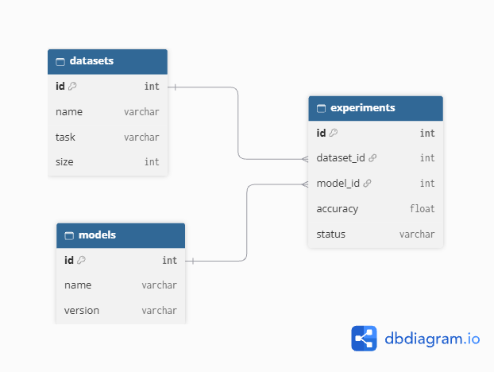

# MiniDB - Own mini-DBMS in Python

Lab work on creating your own database.
The project implements **its own file storage**. All data is stored in text files of its own format.

## Project launch

No third-party libraries are required for operation. You only need Python 3.8+ installed.

### 1. Demo script
Run this script to automatically create a database and fill it with test data (5 datasets, 5 models, 20 experiments):

    python demo.py

### 2. Interactive console interface (CLI)
To manually enter commands and work with the database in real time:

    python -m minidb mydb

## Project architecture

*   `minidb/types.py` - description of the column class (`Column`), data types (`INT`, `STRING`, `FLOAT`), schema validation and serialization.
*   `minidb/table.py` - the single table engine. Responsible for reading/writing files, auto-ID generation, PRIMARY KEY verification, and basic CRUD.
*   `minidb/database.py` - database manager. Manages the catalog of tables, verifies the referential integrity (FOREIGN KEY), implements INNER JOIN and a ban on deleting related data.
*   `minidb/cli.py` - command line interface, user command parsing, and tabular output.

## Own file storage

The entire database is a folder `mydb/`. Each table is represented by two files:
1.  **`{table}.schema`** - a text file with a diagram. Stores a description of the columns in the format: `name|type|flag_pk|fk_table:fk_column`.
2.  **`{table}.tbl`** - a text file with data. Each line is an entry, the fields are separated by a character `|`.

## Implemented functions

- [x] **CREATE TABLE**: creating tables with types (INT, STRING, FLOAT) and PRIMARY KEY.
- [x] **INSERT**: inserting records with auto-generation of the ID (if it is not transmitted) and prohibition of duplication of the PRIMARY KEY.
- [x] **SELECT**: sampling of all data, sampling of specific columns (`columns`), filtering by operators `= != > < >= <=`, logic support `AND` and `OR`.
- [x] **UPDATE**: updating records based on a condition that prohibits changing the PRIMARY KEY.
- [x] **DELETE**: physically deleting records (by overwriting a file).
- [x] **Links (FOREIGN KEY)**: 3 related tables (`experiments.dataset_id -> datasets.id` and `experiments.model_id -> models.id`).
- [x] **Referential integrity**: the database does not allow you to insert an experiment with a non-existent `dataset_id` or delete the referenced dataset..
- [x] **INNER JOIN**: combining tables by key using.

## Database Schema

